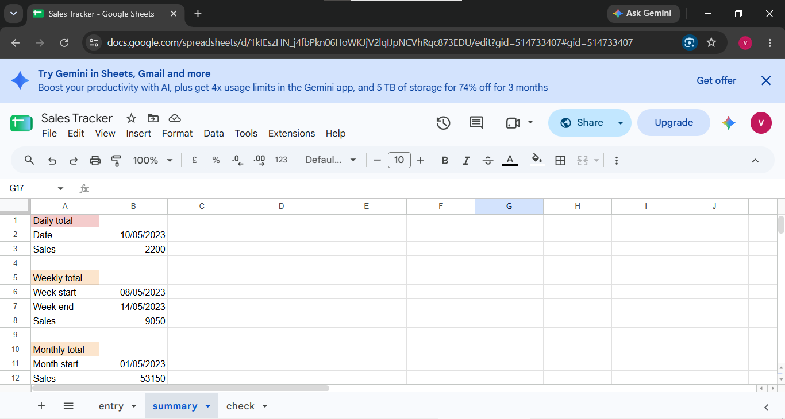
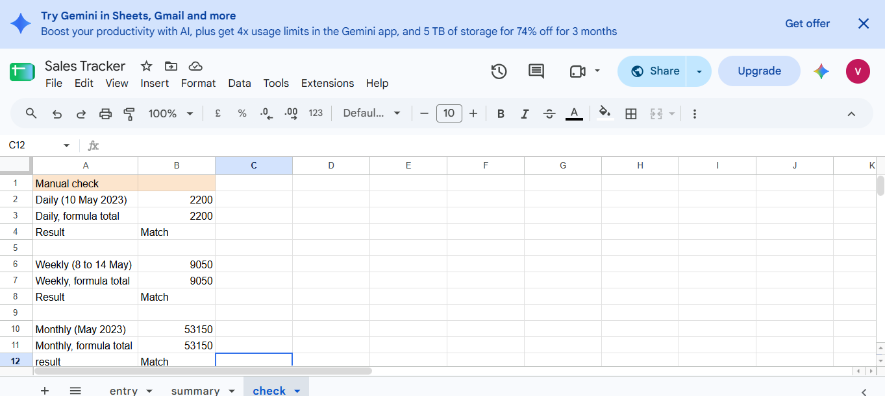

# Sales Tracker in Google Sheets

## Overview
A lightweight sales tracker that auto-calculates daily, weekly and monthly totals
from raw entries. Built on the Retail Sales Dataset (1,000 transactions, 2023).

## Google Sheet
Link: [https://docs.google.com/spreadsheets/d/1kIEszHN_j4fbPkn06HoWKJjV2lqIJpNCVhRqc873EDU/edit?usp=sharing]

## Tabs
- Entry: raw data only (Date, Category, Quantity, Price per Unit, Total Amount)
- Summary: daily, weekly and monthly totals using SUMIFS with date ranges
- Check: totals compared with a manual check (all show Match)

## Data validation
- Date: only valid dates
- Product Category: dropdown (Beauty, Clothing, Electronics)
- Quantity and Price per Unit: numbers greater than 0
- Total Amount for new rows is calculated automatically

## Verified totals
- 10 May 2023: 2,200
- 8 to 14 May 2023: 9,050
- May 2023: 53,150

## Tools Used
Google Sheets (SUMIFS, EDATE, data validation)

## Dataset
Retail Sales Dataset (Kaggle, synthetic data)

## Screenshots

